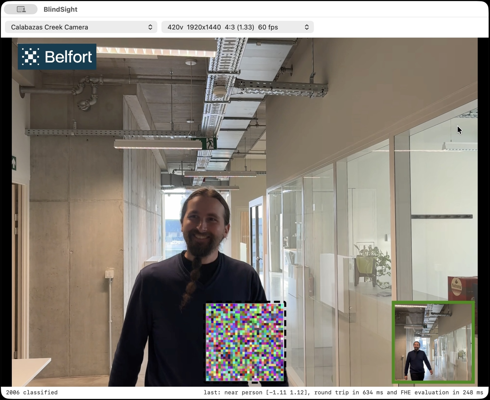
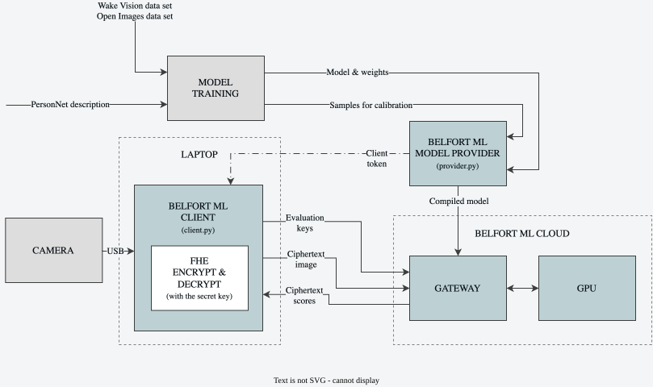

# BlindSight

BlindSight detects whether someone is standing close to a webcam, without ever exposing the video
frames. The client displays the video, captures frames, and encrypts them using FHE (fully
homomorphic encryption). The Belfort eML server performs inference directly on these encrypted
frames, and returns an encrypted verdict. It is end-to-end encrypted: the server never sees the
images. Only the client holds the secret key and can decrypt the verdict.

BlindSight is built with Belfort eML (https://eml.belfortlabs.com). The
[BlindSight blog post](https://belfortlabs.com/blog/encrypted-ai-for-aiot) shows, in its
demonstration video, the whole round trip of an encrypted inference in under one second.



## How it works



What happens to one frame:

1. `client.py` grabs the newest frame from the webcam it is showing.
2. It converts the frame to RGB, centre-crops and resizes it to the model's input size, and
   encrypts it with the secret key.
3. The deploy runs the model on the ciphertext and returns encrypted scores.
4. `client.py` decrypts the scores and shows the verdict.

Capturing, encrypting and decrypting all happen in the one process on your laptop, so the
image never leaves it unencrypted.

Before the first frame can be classified, the deploy needs evaluation keys. These are derived
from the same seed as the client's secret key, and there are two ways to get them onto the
GPU:

- **Developer mode** (`provider.py serve --dev`), which this README uses: the gateway chooses
  the seed and the GPU generates the evaluation keys from it. The provider hands the seed to
  `client.py` together with the client token, so the client uploads nothing and is ready
  within minutes. **For development only:** the gateway knows the seed, so Belfort could
  decrypt everything the deploy serves.
- **Your own keys** (`provider.py serve`): `client.py` draws the seed itself, derives the
  secret key and the evaluation keys from it, and uploads the evaluation keys. Only the client
  ever has the seed, which is the point of the demo, but the upload can take tens of minutes.
  Step 5 of [`eml/README.md`](eml/README.md#5-your-own-keys-serve-without---dev) shows this
  flow.

Either way the keys are made once per client token, not once per frame.

## The model

The detector is PersonNet, a small convolutional network: four layers, about 60k parameters,
built only from operations that are cheap under FHE. Given a 64×64 image, it says whether
there is a person close to the camera. It was trained on
[Wake Vision](https://huggingface.co/datasets/Harvard-Edge/Wake-Vision), with "near person"
labels derived from Open Images' bounding boxes.

The trained weights, `model/training/runs/baseline/best.pt`, are in the repository, so you don't
need to train anything to run the demo. If you want to change the model or the data,
[`model/README.md`](model/README.md) explains how to retrain.

## Repository layout

| Path                            | What |
| ------------------------------- | ---- |
| [`eml/`](eml/README.md)         | the Belfort ML example (eML is short for encrypted ML). `provider.py` compiles and serves the model. `client.py` encrypts images and decrypts verdicts: from the live webcam in a window (macOS, Linux and WSL 2), from sample frames (`--samples`) or from your own images (`--images`). |
| [`model/`](model/README.md)     | PersonNet: its preprocessing, training and plaintext inference, with the trained weights. |
| [`dataset/`](dataset/README.md) | Wake Vision, fetched and labelled: the sample frames for the Belfort ML example, and the training data. |
| [`INSTALL.md`](INSTALL.md)      | the installation steps for macOS, Linux and WSL 2. |
| `assets/`                       | the architecture diagram: `architecture_diagram.drawio` and its SVG export, shown above. |
| `LICENSE`, `NOTICE`             | Apache-2.0, and the attributions for the data the model was trained on (see *Licence*). |

## What you need

- **macOS 14 or newer on Apple Silicon, Linux (x86-64 or ARM), or Windows with WSL 2.**
- **uv and a C++20 compiler.** Every part of the repository runs with `uv run`, which sets up
  its environment the first time, and the Belfort ML client builds its encryption code with
  the compiler the first time it runs. [`INSTALL.md`](INSTALL.md) has the steps for
  each platform; on a Mac that is two commands, on Linux and WSL 2 a few more.
- **A Belfort eML account and an API key.** Sign up on the Belfort eML console at
  [eml.belfortlabs.com](https://eml.belfortlabs.com) with your email address; the console emails
  you a link to activate the account, and a new account comes with 10 credits, or 100 minutes
  of GPU time. Once signed in, open [API keys](https://eml.belfortlabs.com/api-keys) and create
  a key. The console shows it (`blf_live_...`) only once, so copy it then; an account can hold
  up to five active keys. Keep the key out of source code: the provider reads it from the
  `BELFORT_API_KEY` environment variable, which *Run it* below sets with `export`. The
  [eML documentation](https://eml.belfortlabs.com/docs) explains accounts, keys, deploys and
  credits in more detail.
- **Sample frames.** Two labelled sets drawn from Wake Vision. The calibration frames are what
  the model provider calibrates the compiled model on, and the test frames are for checking it
  afterwards. One command downloads and prepares both (about 1.1 GB, a few minutes with a
  Hugging Face login). You need nothing else from the dataset, because the weights are already
  trained:

  ```bash
  cd dataset
  uv run prepare_dataset.py                     # -> dataset/samples/test.npz, calibration.npz
  cd -                                          # back to the repository root
  ```

  [`dataset/README.md`](dataset/README.md) covers the Hugging Face login and the details.

## Run it

You need two terminals, both started from the repository root.

### Terminal 1: the Belfort ML model provider (compile, then deploy)

```bash
cd eml
export BELFORT_API_KEY=blf_live_...           # your API key
uv run provider.py compile                    # once per model; reused after
uv run provider.py serve --dev                # development only: starts a GPU deploy that makes the keys
```

`compile` needs the calibration frames because under FHE every ReLU is replaced by a
polynomial, and a polynomial is only accurate over a limited range. Running the 512 frames in
`dataset/samples/calibration.npz` through the model tells the compiler what those ranges are.
The test frames that `client.py --samples` sends later come from a different split of the
dataset (`dataset/samples/test.npz`), so the model is checked on frames it was not tuned on.

If `compile` fails with `name_taken`, something changed since the model was last compiled: the
weights, the calibration frames, the compile options or the Belfort release. Run
`uv run provider.py delete` and compile again.

`serve --dev` starts a GPU deploy in developer mode: the gateway chooses the secret seed and
the GPU generates the evaluation keys from it. Once the deploy is ready, `serve` writes the
client token to `eml/.client-token` and the seed to `eml/.secret-seed-*` for terminal 2, and
prints both as `export` lines in case the client runs elsewhere. **Developer mode is for
development only**: the gateway knows the seed, so it could decrypt what the deploy serves. To
keep the keys to yourself, serve without `--dev`, as step 5 of
[`eml/README.md`](eml/README.md#5-your-own-keys-serve-without---dev) describes.

**Expect 5 to 10 minutes before the deploy is ready.** The gateway starts a fresh GPU instance,
and the GPU then generates the evaluation keys. The wait is not charged; credits count from the
moment the deploy is ready.

Leave the terminal as it is while you use the client. Press Enter to stop the deploy; it stops
by itself after 30 minutes anyway. You are charged credits for the time it ran, rounded up to
10 minutes.

Steps 1 and 2 of [`eml/README.md`](eml/README.md#1-compile) go into more detail, including
the compile options, and its [*Belfort release*](eml/README.md#belfort-release) section says
which release the packages are pinned to.

### Terminal 2: the Belfort ML client with the webcam

```bash
cd eml
uv run client.py                              # reads the client token terminal 1 wrote
```

If the client runs on another machine, first run the two `export` lines that terminal 1
printed, `BELFORT_CLIENT_TOKEN` and `BELFORT_CLIENT_SECRET_SEED`.

`client.py` starts by building its encryption code, which takes a few minutes the first time,
then makes its key pair from the seed terminal 1 handed over. The GPU already holds the
evaluation keys, so nothing is uploaded, and the window opens once the client is ready to
classify.

**Expect several seconds per frame.** Most of that is sending the ciphertexts between your
computer and the server: the encrypted image going up and the encrypted verdict coming back. The
encrypted inference, also called FHE evaluation, on the GPU only takes a few hundred
milliseconds. The status line shows both numbers, the round-trip time and the FHE evaluation
time, so you can see the split. In the
[BlindSight blog post](https://belfortlabs.com/blog/encrypted-ai-for-aiot), Belfort has shown further
optimizations that bring the whole round trip, from sending the encrypted image to receiving the
encrypted verdict, under one second. Those optimizations are being integrated into eML step by
step, so the time per frame will keep dropping.

The menus let you pick a camera and a format. Any format will do; the frame is cropped and
shrunk to the model's size anyway. The status line under the picture counts the frames
classified on its left and shows the last verdict on its right: the class, the two scores, the
round-trip time and the FHE evaluation time. Along the bottom of the picture, an animation
follows each frame on its trip. On the left, the centre square that the network sees is
snapped out of the picture and turns into noise as it is encrypted. In the middle it waits at
the deploy, inside a black dashed box. On the right it is decrypted again and gets a coloured
box, and that colour is the verdict: dark green means a person is near, dark red means nobody
is, orange means the model is unsure, with the colours blending in between. The terminal
prints the Belfort ML client's status line for every inference. While a frame is being
classified, newer frames are dropped, so the next one sent is always the latest.

On macOS, the first run asks for camera access for your terminal app. If you said no, you can
allow it later in System Settings > Privacy & Security > Camera. On WSL 2 the camera has to be
attached first; see [`INSTALL.md`](INSTALL.md#webcam-on-wsl-2).

Step 3 of [`eml/README.md`](eml/README.md#3-classify-a-live-webcam) describes the client and
the animation in more detail.

### Without a camera

You can also check the compiled model without a camera: run `uv run client.py --samples` in
terminal 2. It encrypts the 64 labelled test frames from `dataset/samples/test.npz`, has the
deploy classify them, decrypts the verdicts and compares each with its label. About 55 of 64
should be right, which is what the model scores in plaintext too. To classify your own photos instead, run
`uv run client.py --images photo.jpg other.png`; any size works. Step 4 of
[`eml/README.md`](eml/README.md#4-or-check-the-compiled-model-with-sample-frames-or-your-own-images)
has the details.

### Stopping

Close the window, press Cmd-Q (macOS) or Ctrl-Q (Linux) in it, or press Ctrl-C in terminal 2;
any of these stops `client.py` cleanly. Stopping the client does not stop the deploy. Press
Enter in terminal 1 for that; the deploy costs credits for as long as it runs, up to 30
minutes.

## Licence

The code, the documentation and the trained weights in `model/training/runs/` are under the
[Apache License 2.0](LICENSE). The weights were trained on
[Wake Vision](https://huggingface.co/datasets/Harvard-Edge/Wake-Vision) (Harvard Edge Computing
Lab, CC BY 4.0), with labels derived from
[Open Images](https://storage.googleapis.com/openimages/web/index.html) bounding-box
annotations (Google, CC BY 4.0). [`NOTICE`](NOTICE) has the attributions and citations; keep
it with the weights if you pass them on. No dataset images are in the repository: they are
Flickr photographs, each under its own licence, and the scripts in `dataset/` download them
from their publishers.
